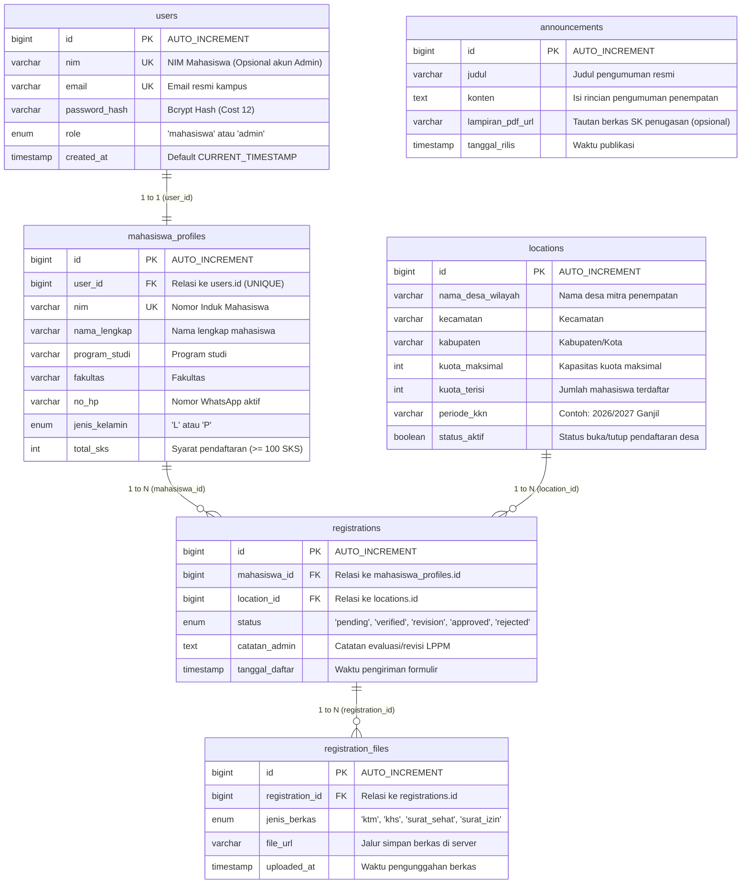

# Entity Relationship Diagram (ERD): SIM KKN LPPM 2026

Dokumen ini mendokumentasikan model konseptual, logikal, dan fisik basis data untuk **Sistem Informasi Pendaftaran Kuliah Kerja Nyata (SIM KKN)** pada basis data relasional **MySQL (`kkn_db`)**.

---

## 1. Visualisasi Diagram ERD (Mermaid)

---

## 2. Kardinalitas & Penjelasan Relasi Antartabel

| Relasi Antartabel | Kardinalitas | Atribut Kunci | Sifat Relasi & Integritas Referensial |
|---|:---:|---|---|
| `users` ➔ `mahasiswa_profiles` | **1 : 1** | `users.id` = `mahasiswa_profiles.user_id` | Setiap akun login mahasiswa memiliki tepat satu profil akademik. Menggunakan `ON DELETE CASCADE` sehingga penghapusan user otomatis menghapus profilnya. |
| `mahasiswa_profiles` ➔ `registrations` | **1 : N** | `mahasiswa_profiles.id` = `registrations.mahasiswa_id` | Satu mahasiswa memiliki riwayat registrasi KKN pada periode berjalan. |
| `locations` ➔ `registrations` | **1 : N** | `locations.id` = `registrations.location_id` | Satu desa mitra menampung banyak mahasiswa pendaftar hingga batas `kuota_maksimal` tercapai (dijaga oleh transaksi atomik basis data). |
| `registrations` ➔ `registration_files` | **1 : N** | `registrations.id` = `registration_files.registration_id` | Satu registrasi pendaftaran memiliki banyak lampiran dokumen pendukung (KTM, Transkrip KHS, Surat Sehat, Surat Izin). Menggunakan `ON DELETE CASCADE`. |

---

## 3. Lokasi File ERD di dalam Proyek

1. **Implementasi Kode Nyata (Auto-Migration DDL):**  
   [`backend/config/schema.js`](../backend/config/schema.js)  
   *File ini dieksekusi secara otomatis oleh Express backend saat server dijalankan untuk membuat 6 tabel MySQL beserta constraint Foreign Key.*
2. **Halaman HTML Interaktif ERD:**  
   [`design/08_erd_database.html`](08_erd_database.html)  
   *Dapat dibuka langsung di browser untuk melihat tampilan kartu entitas tabel yang interaktif.*
3. **Tangkapan Layar Gambar ERD:**  
   [`design/screenshots/08_erd_database.png`](screenshots/08_erd_database.png)
4. **Ringkasan Skema pada Perencanaan:**  
   [`plan.md#5-rancangan-tabel-basis-data-erd-ringkas`](../plan.md)
5. **Dokumentasi pada Makalah UTS:**  
   [`makalah_mpti/MAKALAH_UTS_MPTI_KELOMPOK_2.md`](../makalah_mpti/MAKALAH_UTS_MPTI_KELOMPOK_2.md) (Bagian WP-1.3 dan Bab VI).
