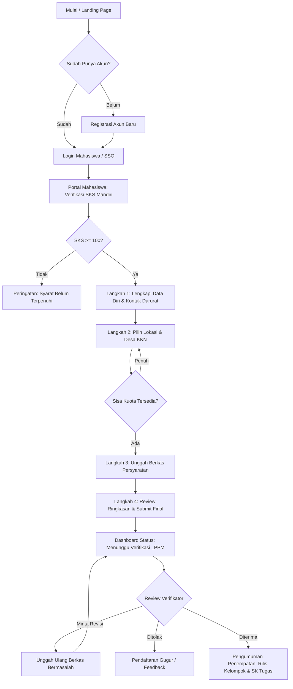
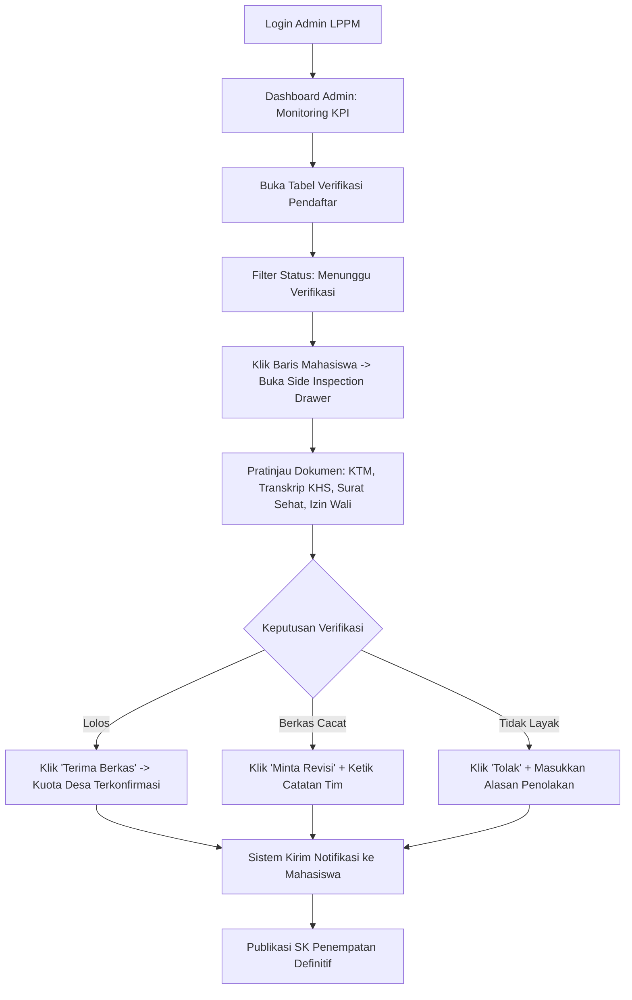

# Dokumentasi UI/UX: SIM KKN LPPM 2026

**Perancang (UI/UX Designer):** Virdi  
**Branch Git:** `virdi-uiux`  
**Proyek Stitch MCP ID:** `8443236148218390349`  
**Design System ID:** `assets/d9a26ec3ff124dcebcb54725dc4f15ee` (*SIM KKN Mahasiswa LPPM*)  

Dokumentasi ini berisi arsitektur antarmuka, design system, user flow, dan katalog halaman high-fidelity (Hi-Fi) interaktif untuk sistem pendaftaran Kuliah Kerja Nyata (KKN). Aset ini disiapkan sebagai acuan implementasi kode oleh **Feris (Frontend React.js)** dan bahan visual laporan Bab 2 oleh **Rayhan (PM)**.

---

## 1. Design System & Style Guide

Sistem desain mengusung tema **Corporate Academic Modernism** yang menggabungkan wibawa institusi kampus dengan kejelasan antarmuka modern yang ramah pengguna.

### A. Palet Warna (Color Palette)

| Kategori | Hex Code | Nama Token | Penggunaan |
|---|---|---|---|
| **Primary** | `#065F46` | Deep Emerald | Tombol utama, header navbar, judul seksi, brand anchor |
| **Primary Container** | `#004532` | Dark Emerald | Background aksen gelap, hover state tombol primary |
| **Secondary (Accent)** | `#10B981` | Vibrant Mint | Status lulus/aktif, indikator live, progress bar kuota aman |
| **Secondary Subtle** | `#ECFDF5` | Mint Wash | Latar belakang chip status lolos, kartu terpilih, alert info |
| **Tertiary** | `#D97706` | Academic Gold | Badge skema khusus (KKN Tematik), penanda urgensi/deadline |
| **Surface Canvas** | `#F8FAFC` | Slate Tint 50 | Latar belakang halaman aplikasi (dokumen academic feel) |
| **Surface Card** | `#FFFFFF` | Pure White | Kartu formulir, kontainer tabel, drawer modal |
| **Text Primary** | `#0F172A` | Slate 900 | Tipografi judul dan teks berbobot utama (WCAG AAA) |
| **Text Secondary** | `#334155` | Slate 700 | Teks deskripsi, label input, metadata |
| **Text Muted** | `#64748B` | Slate 500 | Tanda waktu, helper text, placeholder |
| **Border / Divider** | `#E2E8F0` | Slate 200 | Garis pemisah tabel, batas kartu, garis linimasa |
| **Warning / Revision**| `#D97706` | Amber Warning | Status *Perlu Revisi*, peringatan kuota hampir penuh |
| **Danger / Rejected** | `#BA1A1A` | Crimson Red | Status *Ditolak*, kuota penuh, error validasi |

### B. Tipografi (Typography)

* **Display & Headline Font:** `Space Grotesk`  
  Memberikan sentuhan presisi teknik yang modern dan kokoh untuk istilah kelembagaan kampus.
* **Body & Label Font:** `Plus Jakarta Sans`  
  Tipografi asli desainer Indonesia dengan legibilitas tinggi untuk teks formulir, tabel data, dan petunjuk operasional.

### C. Bentuk & Elevasi (Shapes & Elevation)

* **Radius Sudut:**
  - Base: `0.5rem` (8px) untuk tombol, input teks, dan kartu informasi.
  - Large: `1rem` (16px) untuk banner hero dan kontainer modular besar.
  - Full Pill: `9999px` untuk badge status, avatar inisial, dan tag kuota.
* **Elevasi (Shadows):**
  - Level 1: `box-shadow: 0 1px 3px rgba(15, 23, 42, 0.04)` untuk kartu resting state.
  - Level 2: `box-shadow: 0 4px 6px -1px rgba(15, 23, 42, 0.06)` untuk kartu interaktif / hover.
  - Level 3: `box-shadow: 0 20px 25px -5px rgba(6, 95, 70, 0.08)` untuk modal dialog dan side inspection drawer.

---

## 2. Diagram Alur Pengguna (User Flow)

### A. Alur Pendaftaran Mahasiswa


### B. Alur Verifikasi Admin LPPM


---

## 3. Katalog Halaman High-Fidelity (Hi-Fi)

Semua halaman telah dirancang interaktif berbasis HTML/CSS Tailwind dan siap dipratinjau di browser:

### 1. Landing Page Informasi SIM KKN
* **File HTML:** [01_landing_page.html](01_landing_page.html)
* **Tangkapan Layar:** [01_landing_page.png](screenshots/01_landing_page.png)
* **Komponen Kunci:**
  - Top bar navigasi dengan emblem universitas dan tombol login.
  - Hero banner informatif dengan *live status badge* gelombang pendaftaran.
  - Widget interaktif pengecekan kelayakan SKS mandiri instan via NIM.
  - Kartu panduan 4 langkah pendaftaran mahasiswa.
  - Linimasa agenda pelaksanaan KKN (Sosialisasi -> Pendaftaran -> Pembekalan -> Penerjunan).
  - Katalog cuplikan desa binaan dengan *quota gauge* real-time.
  - FAQ accordion dan kontak helpdesk LPPM.

### 2. Formulir Pendaftaran Multi-Step Mahasiswa
* **File HTML:** [02_pendaftaran_wizard.html](02_pendaftaran_wizard.html)
* **Tangkapan Layar:** [02_pendaftaran_wizard.png](screenshots/02_pendaftaran_wizard.png)
* **Komponen Kunci:**
  - Header portal mahasiswa dengan kartu profil terintegrasi SIAKAD.
  - Horizontal progress stepper 4 tahap (Data Diri -> Pilih Lokasi -> Upload Berkas -> Review).
  - Katalog pemilihan lokasi interaktif dengan pencarian, filter kecamatan, status radio button, dan indikator persentase kuota.
  - Panel upload berkas dengan status verifikasi otomatis (*KTM* & *Transkrip 112 SKS*) dan area drag & drop untuk *Surat Sehat* serta blanko surat persetujuan wali.
  - Bottom sticky navigation bar dengan tombol simpan draf dan aksi navigasi berikutnya.

### 3. Dashboard Admin Console (Verifikasi & Split Drawer)
* **File HTML:** [03_admin_dashboard_verifikasi.html](03_admin_dashboard_verifikasi.html)
* **Tangkapan Layar:** [03_admin_dashboard_verifikasi.png](screenshots/03_admin_dashboard_verifikasi.png)
* **Komponen Kunci:**
  - 5 Kartu metrik KPI (Total pendaftar, antrean verifikasi 84 berkas, pendaftar lolos, butuh revisi, okupansi kuota desa 88%).
  - Toolbar filter tabel terpadu (Search, tab status instan, dropdown kecamatan & fakultas, export CSV).
  - Tabel data pendaftar mahasiswa dengan sorotan baris aktif.
  - Side inspection drawer yang memungkinkan admin memeriksa berkas PDF/gambar tanpa berpindah halaman.
  - Panel keputusan verifikator: tombol *Terima*, *Minta Revisi*, *Tolak*, input catatan tim, dan pengiriman notifikasi otomatis.

### 4. Dashboard Mahasiswa (Status & Penempatan KKN)
* **File HTML:** [04_mahasiswa_dashboard_status.html](04_mahasiswa_dashboard_status.html)
* **Tangkapan Layar:** [04_mahasiswa_dashboard_status.png](screenshots/04_mahasiswa_dashboard_status.png)
* **Komponen Kunci:**
  - Banner perayaan kelulusan resmi dengan Nomor SK LPPM dan tombol unduh Surat Tugas PDF.
  - Kartu penempatan definitif (Desa Cibodas, Lembang) lengkap dengan data DPL (telepon/WhatsApp) dan alamat posko.
  - Roster tim mahasiswa (Kelompok 12) beranggotakan 5 mahasiswa lintas prodi dengan tombol gabung grup WhatsApp.
  - Status kelengkapan berkas yang telah diverifikasi (4/4 lolos).
  - Linimasa agenda pembekalan terpusat dan seremoni pelepasan.

### 5. Halaman Autentikasi (Login & Registrasi Terpadu)
* **File HTML:** [05_autentikasi_login_register.html](05_autentikasi_login_register.html)
* **Tangkapan Layar:** [05_autentikasi_login_register.png](screenshots/05_autentikasi_login_register.png)
* **Komponen Kunci:**
  - Tata letak split-screen 50:50.
  - Kolom kiri: Showcase branding akademik LPPM dengan statistik mahasiswa dan trustmark keamanan data 256-bit.
  - Kolom kanan: Form login terpadu dengan tab switcher (*Mahasiswa*, *Panitia LPPM*, *Daftar Akun Baru*), toggle intip password, integrasi tombol Single Sign-On (SSO) Kampus, dan tautan helpdesk.

---

## 4. Panduan Handoff ke Frontend (Feris)

Untuk memudahkan **Feris (Frontend Developer)** dalam proses slicing ke komponen React.js:

1. **Konfigurasi Font:**
   Tambahkan Google Fonts pada `index.html`:
   ```html
   <link href="https://fonts.googleapis.com/css2?family=Plus+Jakarta+Sans:wght@400;500;600;700&family=Space+Grotesk:wght@600;700&display=swap" rel="stylesheet" />
   ```

2. **Setup Warna Tailwind (`tailwind.config.js`):**
   ```js
   module.exports = {
     theme: {
       extend: {
         colors: {
           primary: '#004532',
           'primary-container': '#065F46',
           'primary-fixed': '#A6F2D1',
           secondary: '#006C49',
           'secondary-fixed': '#6FFBBE',
           'on-surface': '#131B2E',
           'on-surface-variant': '#3F4944',
           background: '#FAF8FF',
           'surface-container-lowest': '#FFFFFF',
           'surface-container-low': '#F2F3FF',
           outline: '#6F7973',
           'outline-variant': '#BEC9C2',
         },
         fontFamily: {
           display: ['Space Grotesk', 'sans-serif'],
           body: ['Plus Jakarta Sans', 'sans-serif'],
         }
       }
     }
   }
   ```

3. **Struktur Komponen React yang Disarankan:**
   ```
   src/
   ├── components/
   │   ├── Navbar.jsx
   │   ├── Footer.jsx
   │   ├── ProgressStepper.jsx
   │   ├── VillageCard.jsx
   │   ├── QuotaBar.jsx
   │   ├── DocumentUploadDropzone.jsx
   │   ├── InspectionDrawer.jsx
   │   └── StatusBadge.jsx
   └── pages/
       ├── LandingPage.jsx
       ├── AuthPage.jsx
       ├── StudentWizardPage.jsx
       ├── StudentDashboardPage.jsx
       └── AdminDashboardPage.jsx
   ```

---

## 5. Ringkasan untuk Laporan Proyek PM (Rayhan)

Screenshot beresolusi tinggi di folder `design/screenshots/` dapat langsung disematkan pada **Bab 2 (Perancangan Sistem & Antarmuka)** pada Laporan Proyek:
- Diagram Alur Pengguna (User Flow) Subbab 2.1
- Panduan Design System & Tipografi Subbab 2.2
- Mockup High-Fidelity & Detail Fitur Subbab 2.3
