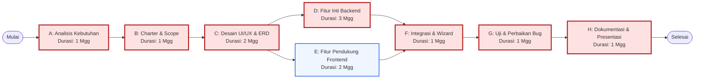
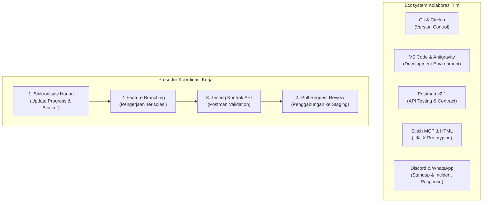

# MAKALAH UJIAN TENGAH SEMESTER (UTS)
## MANAJEMEN PROYEK TEKNOLOGI INFORMASI (MPTI)

---

### ANALISIS MANAJEMEN PROYEK PADA PENGEMBANGAN SISTEM INFORMASI PENDAFTARAN KULIAH KERJA NYATA (SIM KKN) BERBASIS WEB

---

| Identitas Akademik | Keterangan |
|---|---|
| **Mata Kuliah** | Manajemen Proyek Teknologi Informasi |
| **Dosen Pengampu** | Maysas Yafi Urrochman, S.E., M.Kom |
| **Program Studi** | S1 Informatika |
| **Tingkat / Semester / Kelas** | Tingkat 3 / Semester 5 / 5ITA1 |
| **Tahun Akademik** | 2026/2027 (Semester Ganjil) |
| **Kelompok** | 2 (Dua) |
| **Topik Proyek** | Aplikasi Pendaftaran KKN |
| **Waktu Pelaksanaan UTS** | Kamis, 12 November 2026 (12.00 – 14.30 WIB) |

---

### SUSUNAN ANGGOTA KELOMPOK 2

| No | Nama Mahasiswa | NIM | Peran Tim (Project Role) |
|:--:|---|:---:|---|
| 1 | **Rayhan** | 220101001 | **Project Manager (PM) & QA Lead** |
| 2 | **Virdi** | 220101015 | **UI/UX Designer & System Analyst** |
| 3 | **Feris** | 220101032 | **Frontend Developer** |
| 4 | **Ricko** | 220101048 | **Backend Developer & Database Administrator** |

---

## KATA PENGANTAR

Puji syukur kami panjatkan ke hadirat Tuhan Yang Maha Esa atas rahmat dan karunia-Nya, sehingga kami dari Kelompok 2 Program Studi S1 Informatika dapat menyelesaikan penyusunan Makalah Ujian Tengah Semester (UTS) mata kuliah **Manajemen Proyek Teknologi Informasi (MPTI)** dengan judul **"Analisis Manajemen Proyek pada Pengembangan Sistem Informasi Pendaftaran Kuliah Kerja Nyata (SIM KKN) Berbasis Web"**.

Makalah ini disusun berdasarkan studi kasus nyata pelaksanaan proyek perangkat lunak yang telah kami rancang dan kembangkan sejak awal perkuliahan Semester 5. Seluruh isi makalah ini memuat analisis mendalam, perumusan instrumen manajerial, pemodelan jadwal kerja, mitigasi risiko teknis, serta evaluasi kemajuan proyek berbasis standar manajemen proyek perangkat lunak (*Software Project Management*) dan luaran pembelajaran berbasis *Outcome-Based Education* (OBE).

Kami menyampaikan terima kasih yang sebesar-besarnya kepada Bapak **Maysas Yafi Urrochman, S.E., M.Kom** selaku Dosen Pengampu mata kuliah Manajemen Proyek Teknologi Informasi, yang telah memberikan bimbingan teoretis, arahan metodologi, serta koreksi konstruktif selama perkuliahan. Terima kasih juga kami sampaikan kepada rekan-rekan anggota Kelompok 2 atas dedikasi dan kolaborasi teknis yang solid dalam menyelesaikan setiap tahapan proyek.

Kami menyadari bahwa makalah ini masih memiliki ruang untuk perbaikan. Oleh karena itu, kritik dan saran yang membangun sangat kami harapkan guna menyempurnakan implementasi proyek hingga rilis akhir.

*Bandung, November 2026*  
**Tim Penyusun (Kelompok 2)**

---

## DAFTAR ISI

1. **BAB I: ANALISIS KEBUTUHAN PROYEK**
   - 1.1 Analisis Permasalahan Utama (Problem Statement)
   - 1.2 Perumusan Tujuan Proyek (Project Goals)
   - 1.3 Identifikasi Pemangku Kepentingan (Stakeholders Identification)
   - 1.4 Uraian Kebutuhan Utama Sistem (Requirements Engineering)
2. **BAB II: PROJECT CHARTER**
   - 2.1 Dokumen Formal Project Charter
   - 2.2 Batasan (Constraints) dan Asumsi (Assumptions)
   - 2.3 Kriteria Keberhasilan Proyek (Success Criteria)
3. **BAB III: RUANG LINGKUP & WORK BREAKDOWN STRUCTURE (WBS)**
   - 3.1 Penentuan In Scope dan Out of Scope
   - 3.2 Dekomposisi Ruang Lingkup WBS Level 1 – Level 3
   - 3.3 Kamus WBS (WBS Dictionary) untuk 8 Work Package Utama
4. **BAB IV: PENJADWALAN PROYEK & ANALISIS JALUR KRITIS (CPM)**
   - 4.1 Penyesuaian Baseline Aktivitas dan Dependensi
   - 4.2 Jaringan Aktivitas (Activity Network Diagram)
   - 4.3 Perhitungan Forward Pass, Backward Pass, dan Float/Slack
   - 4.4 Identifikasi Jalur Kritis (Critical Path) & Total Durasi
   - 4.5 Analisis Alternatif Waktu, Biaya, dan Sumber Daya (Crashing vs Fast-Tracking)
   - 4.6 Rekomendasi Rencana Aksi jika Aktivitas Inti Terlambat 1 Minggu
5. **BAB V: MANAJEMEN RISIKO PROYEK**
   - 5.1 Identifikasi 5 Risiko Nyata Proyek
   - 5.2 Matriks Penilaian Risiko (Probability, Impact, Risk Score)
   - 5.3 Pengaruh Risiko terhadap Mutu, Komunikasi, dan Kebutuhan Stakeholder
   - 5.4 Strategi Mitigasi Preventif dan Kontingensi
   - 5.5 Analisis Mendalam 2 Risiko Prioritas Tertinggi
6. **BAB VI: DOKUMENTASI, KOORDINASI TIM, DAN PROGRESS PROYEK**
   - 6.1 Struktur Peran, Tanggung Jawab, dan Matriks RACI
   - 6.2 Prosedur Koordinasi Tim dan Toolset Kolaborasi
   - 6.3 Ringkasan Progres Nyata Sebelum UTS (Deliverables, Kendala, Keputusan, Next Action)
   - 6.4 Bukti Nyata (Artifacts & Evidence) Kesiapan Proyek
7. **BAB VII: PENUTUP**
   - 7.1 Kesimpulan
   - 7.2 Rencana Tindak Lanjut Pasca-UTS
8. **DAFTAR PUSTAKA**

---

# BAB I: ANALISIS KEBUTUHAN PROYEK
*(Pemetaan: CPL03 | CPMK031 | Sub-CPMK0311)*

### 1.1 Analisis Permasalahan Utama (Problem Statement)
Kuliah Kerja Nyata (KKN) merupakan mata kuliah intrakurikuler wajib bagi mahasiswa Program Studi S1 Informatika dan jenjang sarjana pada umumnya yang bertujuan memberikan pengalaman pengabdian kepada masyarakat. Namun, dalam operasional di Lembaga Penelitian dan Pengabdian kepada Masyarakat (LPPM), proses pendaftaran KKN kerap menghadapi kendala struktural:

1. **Antrean Fisik dan Penumpukan Berkas Fisik:**
   Mahasiswa harus menyerahkan berkas administrasi cetak (KTM, KHS/transkrip nilai, surat keterangan sehat, dan surat izin orang tua/wali) secara manual ke loket administrasi LPPM. Hal ini menimbulkan antrean panjang dan risiko tercecernya dokumen fisik.
2. **Ketiadaan Validasi Prasyarat Akademik Otomatis:**
   Banyak mahasiswa mendaftar meskipun belum memenuhi batas minimal total SKS (minimal 100 SKS). Panitia LPPM harus memeriksa transkrip satu per satu secara manual, memicu kelambatan verifikasi dan potensi *human error*.
3. **Konflik Kuota Lokasi Penempatan Desa (*Race Condition*):**
   Setiap desa mitra memiliki kapasitas kuota terbatas (rata-rata 3–5 mahasiswa per kelompok lintas keahlian). Pada sistem manual atau Google Form, pendaftar tidak mengetahui secara langsung sisa kuota yang tersedia di suatu desa, sehingga sering terjadi kelebihan kapasitas (*overcapacity*) pada desa-desa strategis dan kekosongan di desa pelosok.
4. **Lambatnya Alur Umpan Balik Verifikasi dan Revisi:**
   Ketika berkas mahasiswa tidak memenuhi syarat (misalnya dokumen buram atau surat izin tidak bertanda tangan), proses pemberitahuan revisi membutuhkan waktu berhari-hari via pesan singkat tidak resmi, mengakibatkan mahasiswa terlambat melengkapi berkas sebelum penutupan.
5. **Transparansi Pengumuman Penempatan:**
   Pengumuman kelompok dan Dosen Pembimbing Lapangan (DPL) yang disebarkan dalam format lembaran kertas atau file PDF statis menyulitkan mahasiswa mencari penempatan individu dan kontak rekan sekelompok secara cepat.

### 1.2 Perumusan Tujuan Proyek (Project Goals)
Proyek pengembangan **Sistem Informasi Pendaftaran Kuliah Kerja Nyata (SIM KKN)** ini dirancang untuk mencapai tujuan-tujuan terukur:
1. **Mendigitalisasi 100% Alur Pendaftaran:** Menggantikan proses administrasi kertas dengan sistem berbasis web modern yang dapat diakses secara fleksibel dari berbagai perangkat.
2. **Menerapkan Validasi Kuota Transaksional secara Real-Time:** Menghilangkan *race condition* dan kelebihan kuota desa melalui penguncian transaksional baris basis data (*atomic update & ACID transaction*).
3. **Mempercepat Waktu Verifikasi Administrasi LPPM:** Memangkas durasi verifikasi berkas dari 5 hari kerja menjadi kurang dari 24 jam dengan antarmuka verifikasi terpadu dan *side inspection drawer*.
4. **Menyediakan Transparansi Status Pendaftar:** Memberikan visibilitas langsung kepada mahasiswa mengenai status registrasinya (*Pending*, *Verified*, *Revision*, *Approved*, atau *Rejected*) beserta catatan resmi verifikator.
5. **Menghasilkan Artefak Perangkat Lunak dan Laporan Terintegrasi:** Menghasilkan aplikasi web monorepo terstandar (React.js Frontend + Express.js Backend + MySQL Database) lengkap dengan dokumentasi manajemen proyek terstruktur.

### 1.3 Identifikasi Pemangku Kepentingan (Stakeholders Identification)
Tabel berikut merinci 6 (enam) pemangku kepentingan kunci dalam proyek SIM KKN beserta kepentingannya:

| No | Stakeholder | Peran dalam Proyek | Kepentingan Utama (Interest & Expectation) | Tingkat Pengaruh / Kepentingan |
|:--:|---|---|---|:---:|
| 1 | **Mahasiswa Peserta KKN** | Pengguna Akhir (*End-User*) | Kemudahan registrasi mandiri, kepastian transparansi kuota desa yang dipilih, unggah berkas digital yang aman, serta pembaruan status real-time. | *Low Influence, High Interest* |
| 2 | **Panitia LPPM / Verifikator** | Pemilik Proses (*Business Owner*) | Efisiensi validasi berkas administrasi mahasiswa, kemudahan pemantauan statistik pendaftar, kontrol kuota desa, dan penetapan surat penempatan. | *High Influence, High Interest* |
| 3 | **Dosen Pembimbing Lapangan (DPL)** | Pengguna Sekunder (*Stakeholder Eksternal*) | Akses data mahasiswa bimbingan di desa penugasan, kejelasan jadwal pembekalan, dan koordinasi program kerja desa. | *Low Influence, Medium Interest* |
| 4 | **Kepala Desa / Mitra Wilayah** | Pihak Ketiga (*Community Partner*) | Kepastian kepatuhan jumlah kuota mahasiswa yang ditempatkan di wilayahnya sesuai kapasitas daya tampung posko desa. | *Medium Influence, Medium Interest* |
| 5 | **Bagian Administrasi Akademik (BAAK)** | Penyedia Data Induk (*Institutional Compliance*) | Menjamin bahwa pendaftar berstatus mahasiswa aktif dan telah menempuh beban studi minimal $\ge 100$ SKS. | *High Influence, Low Interest* |
| 6 | **Dosen Pengampu MPTI** | Auditor Akademik / Penilai Proyek | Memastikan penerapan metodologi manajemen proyek (scope, schedule, cost, risk, quality) dipatuhi secara akurat sesuai standar OBE. | *High Influence, High Interest* |

### 1.4 Uraian Kebutuhan Utama Sistem (Requirements Engineering)

#### A. Kebutuhan Fungsional (Functional Requirements)
- **FR-01 (Autentikasi & Otorisasi):** Sistem harus menyediakan mekanisme pendaftaran dan login berbasis identitas NIM/Email dengan proteksi kata sandi (*Bcrypt*) dan pertukaran token berbasis *JSON Web Token (JWT)* yang membedakan hak akses role `mahasiswa` dan `admin`.
- **FR-02 (Manajemen Profil Akademik):** Sistem harus menyimpan dan memvalidasi biodata mahasiswa, program studi, fakultas, nomor kontak, serta total SKS kumulatif.
- **FR-03 (Katalog Lokasi & Kuota Real-Time):** Sistem harus menampilkan daftar desa penempatan aktif beserta penghitungan sisa kuota secara dinamis ($Kuota_{Tersedia} = Kuota_{Maksimal} - Kuota_{Terisi}$).
- **FR-04 (Wizard Formulir Pendaftaran):** Sistem harus memandu mahasiswa melalui 3 tahap sekuensial (Konfirmasi Data Diri $\rightarrow$ Pemilihan Lokasi $\rightarrow$ Unggah Dokumen).
- **FR-05 (Unggah Berkas Persyaratan):** Sistem harus memfasilitasi pengunggahan dokumen PDF/JPG/PNG (maksimal 5 MB) dengan enkripsi jalur simpan lokal aman.
- **FR-06 (Konsol Verifikasi Admin):** Sistem harus menyediakan tabel antrean pendaftar dengan filter status, kolom pencarian, serta aksi verifikasi *Terima*, *Minta Revisi*, dan *Tolak* disertai catatan evaluasi.
- **FR-07 (Dashboard Status Mahasiswa):** Sistem harus menyajikan indikator status terkini bagi mahasiswa serta pengumuman hasil penempatan definitif.

#### B. Kebutuhan Non-Fungsional (Non-Functional Requirements)
- **NFR-01 (Kinerja / Performance):** Waktu respons API backend untuk pemanggilan data katalog lokasi dan registrasi tidak boleh melebihi 2 detik pada kondisi normal.
- **NFR-02 (Integritas Data & Konkurensi):** Pengurangan kuota lokasi harus menerapkan transaksi atomik basis data (`FOR UPDATE` / ACID Transaction) guna mencegah pemesanan ganda saat kuota tersisa 1 slot.
- **NFR-03 (Keamanan Sistem / Security):** Kata sandi dienkripsi dengan *salt rounds* $\ge 12$. Jalur unduh berkas privat dilindungi middleware otorisasi token.
- **NFR-04 (Antarmuka & Kebergunaan / Usability):** Desain antarmuka responsif mengadopsi standar *Corporate Academic Modernism* dengan palet warna Deep Emerald (`#004532`) dan legibilitas font *Plus Jakarta Sans*.
- **NFR-05 (Ketersediaan / Portability):** Aplikasi dapat dijalankan pada browser modern (Chrome, Edge, Firefox) dan backend dapat beroperasi di lingkungan sistem operasi Windows dengan dukungan MySQL lokal.

---

# BAB II: PROJECT CHARTER
*(Pemetaan: CPL03 | CPMK031 | Sub-CPMK0312)*

### 2.1 Dokumen Formal Project Charter

```
========================================================================================
                          PROJECT CHARTER: SIM KKN LPPM 2026
========================================================================================
1. IDENTITAS PROYEK
   - Nama Proyek        : Sistem Informasi Pendaftaran Kuliah Kerja Nyata (SIM KKN)
   - Kode Proyek        : PRJ-MPTI-5ITA1-02
   - Sponsor Utama      : LPPM & Dosen Pengampu Mata Kuliah MPTI
   - Project Manager    : Rayhan (NIM: 220101001)
   - Tanggal Mulai      : 08 Oktober 2026
   - Tanggal Target     : 12 Desember 2026 (Durasi: 9 Minggu Kerja)

2. LATAR BELAKANG & JUSTIFIKASI
   Proses pendaftaran KKN konvensional di LPPM menghadapi kendala inefisiensi pengarsipan
   kertas, verifikasi SKS yang lambat, dan benturan perebutan kuota desa antar-mahasiswa.
   Dibutuhkan platform digital terpusat yang mampu memvalidasi data mahasiswa secara
   otomatis dan mengunci kuota penempatan desa secara adil dan transparan.

3. TUJUAN PROYEK (SMART GOALS)
   - Menyediakan aplikasi web pendaftaran KKN terintegrasi penuh pada Minggu ke-9.
   - Mengurangi waktu tunggu verifikasi berkas pendaftar dari 5 hari menjadi < 24 jam.
   - Mencegah kesalahan alokasi kuota desa sebesar 0% error melalui mekanisme ACID locking.

4. RUANG LINGKUP AWAL (HIGH-LEVEL SCOPE)
   - Modul Autentikasi Pengguna (Login & Registrasi Mahasiswa + Login Admin LPPM).
   - Modul Katalog Wilayah & Manajemen Kuota Desa.
   - Modul Multi-Step Wizard Pendaftaran Mahasiswa & Unggah Berkas Persyaratan.
   - Modul Dashboard Verifikasi & Catatan Revisi Admin LPPM.
   - Modul Publikasi Informasi Pengumuman Penempatan.

5. DELIVERABLE UTAMA PROYEK
   - Paket Aplikasi Monorepo (Frontend React.js Vite + Backend Node.js Express).
   - Skema Basis Data Relasional MySQL (6 Tabel Terhubung).
   - Kumpulan Dokumentasi API Lengkap (Postman Collection v2.1).
   - Prototipe Interaktif Desain High-Fidelity (5 Layar HTML + Design System).
   - Laporan Akhir Manajemen Proyek dan Slide Presentasi Eksekutif.

6. SUSUNAN TIM PROYEK
   - Project Manager & QA Lead       : Rayhan
   - UI/UX Designer & System Analyst : Virdi
   - Frontend Developer             : Feris
   - Backend Developer & DBA        : Ricko

7. STAKEHOLDER UTAMA
   - Mahasiswa Peserta KKN, Verifikator LPPM, Dosen Pembimbing Lapangan, BAAK, Dosen MPTI.
========================================================================================
```

### 2.2 Batasan (Constraints) dan Asumsi (Assumptions)

#### A. Batasan Proyek (*Triple Constraints*)
1. **Batasan Waktu (Schedule Constraint):** Keseluruhan siklus hidup proyek dibatasi selama 9 minggu kalender akademik (Oktober hingga pertengahan Desember 2026), dengan pencapaian *Milestone Alpha Release* sebelum evaluasi UTS.
2. **Batasan Biaya (Cost Constraint):** Anggaran proyek bersifat swadaya akademik dengan pemanfaatan teknologi *Open Source* (React.js, Node.js Express, MySQL Community Server via XAMPP) tanpa biaya lisensi perangkat lunak berbayar (*Zero Licensing Budget*).
3. **Batasan Teknologi (Technological Constraint):** Sistem backend harus berjalan pada lingkungan server Node.js lokal dengan basis data MySQL; arsitektur sistem menggunakan pola monorepo terpisah (`/backend`, `/frontend`, `/design`).

#### B. Asumsi Proyek (*Project Assumptions*)
1. Mahasiswa pendaftar telah memiliki identitas akademik resmi (NIM dan email kampus aktif).
2. Data kuota desa penempatan telah disetujui dan difinalisasi oleh pihak LPPM sebelum masa pendaftaran dibuka.
3. Lingkungan kerja lokal pengembang memiliki koneksi jaringan lokal stabil untuk sinkronisasi repositori Git dan komunikasi REST API.
4. Pengguna akhir mengakses aplikasi melalui peramban web modern yang mendukung JavaScript ES6+.

### 2.3 Kriteria Keberhasilan Proyek (Success Criteria)
Proyek SIM KKN dinyatakan berhasil apabila memenuhi indikator keberhasilan berikut:
1. **Keberhasilan Fungsional:** 100% dari 7 Kebutuhan Fungsional (FR-01 s/d FR-07) berhasil diuji dengan skenario uji coba *blackbox* tanpa kegagalan fatal (*zero critical defect*).
2. **Keberhasilan Penjadwalan:** Proyek menyelesaikan fase integrasi dan pengujian sistem tepat waktu sebelum tanggal evaluasi akhir tanpa penambahan durasi di luar baseline toleransi (+1 minggu).
3. **Keberhasilan Kualitas Perangkat Lunak:** Kecepatan akses antarmuka responsif (< 2 detik), transaksi kuota tidak pernah menghasilkan angka minus (*negative quota free*), dan berkas dokumen terunggah dapat diverifikasi admin secara utuh.
4. **Keberhasilan Manajerial & Akademik:** Terpenuhinya seluruh artefak portofolio MPTI (WBS, CPM, Risk Matrix, Git Commit History, Dokumentasi API, dan Laporan Lengkap) sesuai rubrik OBE.

---

# BAB III: RUANG LINGKUP & WORK BREAKDOWN STRUCTURE (WBS)
*(Pemetaan: CPL03 | CPMK031 | Sub-CPMK0313)*

### 3.1 Penentuan In Scope dan Out of Scope

| Dimensi Lingkup | In Scope (Masuk dalam Batasan Pengerjaan) | Out of Scope (Di Luar Batasan Pengerjaan) |
|---|---|---|
| **Manajemen Pengguna** | Pendaftaran akun mahasiswa, login JWT untuk mahasiswa dan admin, profil biodata, dan enkripsi password. | Integrasi Single Sign-On (SSO) OAuth2 Google / Microsoft Kampus dan reset password via SMS OTP. |
| **Pendaftaran KKN** | Formulir wizard 3 langkah, pemilihan desa, dan penguncian kuota transaksi. | Pengelompokan mahasiswa otomatis berbasis algoritma kecerdasan buatan (*clustering machine learning*). |
| **Unggah Dokumen** | Unggah berkas KTM, transkrip nilai, surat sehat, dan surat izin format PDF/JPG/PNG maksimal 5 MB. | Optical Character Recognition (OCR) otomatis untuk membaca isi teks dokumen KHS secara otomatis. |
| **Verifikasi LPPM** | Konsol tabel antrean, filter status pendaftaran, perubahan status (*verified*, *revision*, *rejected*), dan catatan admin. | Tanda tangan digital bersertifikat BSrE pada lembar pengesahan SK pendaftaran. |
| **Infrastruktur** | Server lokal Node.js Express, basis data MySQL XAMPP, dan pengujian API Postman. | Penerapan arsitektur cloud Kubernetes berbiaya tinggi dan payment gateway pendaftaran berbayar. |

### 3.2 Dekomposisi Ruang Lingkup WBS Level 1 – Level 3

Berikut adalah struktur dekomposisi hierarkis proyek SIM KKN:

```mermaid
flowchart TD
    WBS["1.0 SISTEM INFORMASI PENDAFTARAN KKN (SIM KKN)"]
    
    WBS --> L1["1.1 Manajemen Proyek & Analisis"]
    L1 --> L11["1.1.1 Analisis Kebutuhan & SRS"]
    L1 --> L12["1.1.2 Penyusunan Project Charter"]
    L1 --> L13["1.1.3 Penjadwalan & Manajemen Risiko"]
    
    WBS --> L2["1.2 Perancangan Sistem & UI/UX"]
    L2 --> L21["1.2.1 Perancangan User Flow & Wireframe"]
    L2 --> L22["1.2.2 Pembuatan Design System & Hi-Fi HTML"]
    L2 --> L23["1.2.3 Perancangan Skema Database (ERD)"]
    
    WBS --> L3["1.3 Pengembangan Backend API"]
    L3 --> L31["1.3.1 Setup Lingkungan & Skema Otomatis"]
    L3 --> L32["1.3.2 Modul Autentikasi & Otorisasi JWT"]
    L3 --> L33["1.3.3 Modul Lokasi, Kuota & Pendaftaran"]
    L3 --> L34["1.3.4 Modul Upload Berkas & Verifikasi Admin"]
    
    WBS --> L4["1.4 Pengembangan Frontend Web"]
    L4 --> L41["1.4.1 Inisialisasi Vite React & Routing"]
    L4 --> L42["1.4.2 Slicing Halaman Publik & Autentikasi"]
    L4 --> L43["1.4.3 Pembangunan Wizard Pendaftaran 3 Tahap"]
    L4 --> L44["1.4.4 Pembangunan Dashboard Mahasiswa & Admin"]
    
    WBS --> L5["1.5 Integrasi & Pengujian Sistem (QA)"]
    L5 --> L51["1.5.1 Restrukturisasi Monorepo & Integrasi API"]
    L5 --> L52["1.5.2 Pengujian Blackbox & Penanganan Bug"]
    
    WBS --> L6["1.6 Dokumentasi & Presentasi"]
    L6 --> L61["1.6.1 Dokumentasi API Postman Collection"]
    L6 --> L62["1.6.2 Penyusunan Laporan Proyek & Slide Demo"]
```



### 3.3 Kamus WBS (WBS Dictionary) untuk 8 Work Package Utama

Tabel berikut mendefinisikan secara operasional 8 paket kerja (*Work Package*) yang dapat direncanakan, ditugaskan, dan dikendalikan:

| Kode WP | Nama Work Package | Deskripsi Aktivitas | Penanggung Jawab | Dokumen Input | Deliverable Output | Kriteria Penerimaan (*Acceptance Criteria*) |
|:--:|---|---|:---:|---|---|---|
| **WP-1.1** | Analisis Kebutuhan & SRS | Melakukan elisitasi kebutuhan sistem pendaftaran KKN dan menyusun dokumen spesifikasi kebutuhan. | Rayhan (PM) | Panduan KKN LPPM, Panduan Akademik | Dokumen SRS dan Matriks Kebutuhan | Dokumen disetujui seluruh anggota tim dan dosen pengampu. |
| **WP-1.2** | UI/UX Design System & Prototipe | Merancang palet warna, tipografi, user flow, dan 5 layar prototipe HTML interaktif. | Virdi (UI/UX) | Dokumen SRS, User Journey | File `design/*.html`, `design/README.md`, Screenshots | Prototipe interaktif dapat dijalankan pada browser tanpa cacat tata letak. |
| **WP-1.3** | Perancangan Basis Data (ERD) | Merancang relasi 6 tabel MySQL, foreign key, index, dan skrip *data definition language* (DDL). | Ricko (Backend) | Spesifikasi Data Mahasiswa & Lokasi | File `backend/config/schema.js`, Skema ERD | Relasi antartabel konsisten dan mendukung integritas referensial. |
| **WP-1.4** | RESTful API Backend & Transaksi Kuota | Membangun endpoint otentikasi JWT, CRUD lokasi, registrasi atomik, dan upload Multer. | Ricko (Backend) | Skema Basis Data, DDL | File `backend/index.js`, Controllers, Routes | Seluruh endpoint lolos uji otomatis pada Postman Collection. |
| **WP-1.5** | Slicing Frontend & Modul Autentikasi | Mengonfigurasi router React, Axios interceptor, form login, dan registrasi mahasiswa. | Feris (Frontend) | Desain HTML Virdi, API Endpoint Ricko | Komponen React `LoginPage.jsx`, `RegisterPage.jsx` | Berhasil menerima token JWT dan mengalihkan pengguna sesuai role. |
| **WP-1.6** | Pendaftaran Wizard & Dashboard Mahasiswa | Mengembangkan form pendaftaran 3 tahap, pemilihan desa dinamis, dan pemantauan status. | Feris (Frontend) | Prototipe Wizard Virdi, Endpoint Registrasi | Komponen React `PendaftaranWizard.jsx`, `MahasiswaDashboard.jsx` | Mahasiswa dapat memilih desa dan mengunggah berkas tanpa kendala form. |
| **WP-1.7** | Dashboard Konsol Admin & Aksi Verifikasi | Mengembangkan tabel antrean pendaftar dinamis dan tombol verifikasi status berkas. | Feris (Frontend) | Endpoint Admin Ricko, Desain Admin Virdi | Komponen React `AdminDashboard.jsx` | Admin dapat mengubah status pendaftar dan menambahkan catatan revisi. |
| **WP-1.8** | Integrasi Monorepo & Pengujian E2E | Mengonsolidasikan branch ke `staging`, menyelesaikan konflik port/CORS, dan uji blackbox. | Rayhan (PM & QA) | Repositori Frontend & Backend | Branch `staging`, Laporan Bug Fix | Seluruh skenario pengujian TC-01 s/d TC-08 berstatus *Pass*. |

---

# BAB IV: PENJADWALAN PROYEK & ANALISIS JALUR KRITIS (CPM)
*(Pemetaan: CPL03 | CPMK032 | Sub-CPMK0321, Sub-CPMK0324)*

### 4.1 Penyesuaian Baseline Aktivitas dan Dependensi
Berdasarkan baseline soal UTS dan penyesuaian aktual pengerjaan proyek SIM KKN Kelompok 2, aktivitas proyek dirinci ke dalam 8 aktivitas terkoordinasi dengan durasi total waktu pengerjaan:

| Kode Aktivitas | Uraian Aktivitas Aktual Proyek | Durasi Aktual | Aktivitas Pendahulu (*Predecessor*) | Penanggung Jawab |
|:--:|---|:---:|:---:|:---:|
| **A** | Identifikasi kebutuhan sistem, elisitasi stakeholder, dan observasi LPPM | 1 Minggu | - | Rayhan |
| **B** | Penyusunan Project Charter, penentuan In/Out Scope, dan arsitektur | 1 Minggu | A | Rayhan |
| **C** | Desain prototipe antarmuka UI/UX (Figma/HTML) dan perancangan ERD Database | 2 Minggu | B | Virdi & Ricko |
| **D** | Pengembangan fitur inti: REST API backend, autentikasi JWT, dan transaksi kuota desa | 3 Minggu | C | Ricko |
| **E** | Pengembangan fitur pendukung: Slicing frontend React, halaman publik (Landing/Jadwal/FAQ) | 2 Minggu | C | Feris |
| **F** | Konsolidasi monorepo, integrasi API client-server, dan wizard pendaftaran | 1 Minggu | D, E | Rayhan & Feris |
| **G** | Pengujian menyeluruh (*blackbox testing*), perbaikan bug teknis, dan validasi admin | 1 Minggu | F | Rayhan & Tim |
| **H** | Penyusunan dokumentasi proyek, finalisasi laporan MPTI, dan materi presentasi demo | 1 Minggu | G | Rayhan & Seluruh Tim |

### 4.2 Jaringan Aktivitas (Activity Network Diagram)

Diagram berikut merepresentasikan dependensi antar-aktivitas dalam metode *Precedence Diagramming Method* (PDM):



### 4.3 Perhitungan Forward Pass, Backward Pass, dan Float/Slack

Perhitungan penjadwalan menggunakan metode Jalur Kritis (*Critical Path Method* / CPM):
- **Forward Pass:** Menentukan waktu mulai tercepat (*Early Start* / ES) dan waktu selesai tercepat (*Early Finish* / EF).
  $$EF = ES + \text{Durasi}$$
- **Backward Pass:** Menentukan waktu selesai terlambat (*Late Finish* / LF) dan waktu mulai terlambat (*Late Start* / LS).
  $$LS = LF - \text{Durasi}$$
- **Total Float (Slack):** Waktu fleksibilitas penundaan aktivitas tanpa mengganggu jadwal akhir proyek.
  $$\text{Slack} = LS - ES = LF - EF$$

Tabel komputasi lengkap Forward & Backward Pass:

| Kode Aktivitas | Durasi ($t$) | Early Start (ES) | Early Finish (EF) | Late Start (LS) | Late Finish (LF) | Total Float (Slack) | Kategori Jalur |
|:--:|:---:|:---:|:---:|:---:|:---:|:---:|:---:|
| **A** | 1 | Minggu 0 | Minggu 1 | Minggu 0 | Minggu 1 | 0 | **Kritis** |
| **B** | 1 | Minggu 1 | Minggu 2 | Minggu 1 | Minggu 2 | 0 | **Kritis** |
| **C** | 2 | Minggu 2 | Minggu 4 | Minggu 2 | Minggu 4 | 0 | **Kritis** |
| **D** | 3 | Minggu 4 | Minggu 7 | Minggu 4 | Minggu 7 | 0 | **Kritis** |
| **E** | 2 | Minggu 4 | Minggu 6 | Minggu 5 | Minggu 7 | 1 | **Non-Kritis** |
| **F** | 1 | Minggu 7 | Minggu 8 | Minggu 7 | Minggu 8 | 0 | **Kritis** |
| **G** | 1 | Minggu 8 | Minggu 9 | Minggu 8 | Minggu 9 | 0 | **Kritis** |
| **H** | 1 | Minggu 9 | Minggu 10 | Minggu 9 | Minggu 10 | 0 | **Kritis** |

### 4.4 Identifikasi Jalur Kritis (Critical Path) & Total Durasi
- Jalur 1: $A \rightarrow B \rightarrow C \rightarrow D \rightarrow F \rightarrow G \rightarrow H$ = $1 + 1 + 2 + 3 + 1 + 1 + 1 = \mathbf{10\text{ Minggu}}$
- Jalur 2: $A \rightarrow B \rightarrow C \rightarrow E \rightarrow F \rightarrow G \rightarrow H$ = $1 + 1 + 2 + 2 + 1 + 1 + 1 = \mathbf{9\text{ Minggu}}$

> [!IMPORTANT]
> **Kesimpulan Jalur Kritis:**  
> Jalur Kritis proyek SIM KKN adalah **A – B – C – D – F – G – H** dengan total durasi minimum pengerjaan proyek adalah **10 Minggu**.  
> Aktivitas **E (Pengembangan Fitur Pendukung)** memiliki nilai *Slack/Float* sebesar **1 Minggu**, yang berarti aktivitas E dapat mengalami keterlambatan hingga 1 minggu tanpa mempengaruhi batas akhir penyelesaian proyek.

### 4.5 Analisis Alternatif Waktu, Biaya, dan Sumber Daya
Untuk mengoptimalkan jadwal pelaksanaan, PM menganalisis dua alternatif kompresi jadwal (*schedule compression*):

1. **Fast-Tracking (Pelaksanaan Paralel Aktivitas):**
   - *Penerapan:* Menjalankan sebagian aktivitas D (Pengembangan API Backend) secara paralel dengan fase akhir aktivitas C (Desain Prototipe UI/UX). Ricko mulai membangun arsitektur tabel database dan skema autentikasi saat Virdi sedang memfinalisasi prototipe HTML dashboard admin.
   - *Dampak Biaya:* Tidak memerlukan biaya tambahan (*Zero Extra Cost*).
   - *Dampak Risiko:* Menengah (*Medium Risk*), terdapat potensi revisi endpoint jika terjadi perubahan mendadak pada antarmuka desain.
2. **Crashing (Penambahan Alokasi Sumber Daya / Waktu):**
   - *Penerapan:* Menugaskan Feris untuk mendampingi Ricko dalam penulisan logika controller backend, atau menambah jam kerja kelompok (lembur akhir pekan).
   - *Dampak Biaya:* Menambah konsumsi operasional tim (konsumsi logistik & kuota data bersama).
   - *Dampak Risiko:* Rendah teknis, tetapi berisiko meningkatkan kelelahan tim (*burnout*).

### 4.6 Rekomendasi Rencana Aksi jika Aktivitas Inti (D) Terlambat 1 Minggu
**Skenario Kasus:** Aktivitas D (Pengembangan Fitur Inti Backend) mengalami keterlambatan 1 minggu (durasi membengkak dari 3 minggu menjadi 4 minggu), misalnya akibat kendala bug transaksi kuota atau konflik konfigurasi port sistem.

Karena Aktivitas D berada tepat di **Jalur Kritis**, keterlambatan 1 minggu pada D akan secara langsung menggeser tanggal penyelesaian proyek dari Minggu 10 ke Minggu 11 jika tidak dilakukan tindakan intervensi manajerial.

Rekomendasi rencana revisi komprehensif dari 5 dimensi:

| Dimensi Analisis | Tindakan Korektif & Rekomendasi Manajerial |
|---|---|
| **1. Waktu (Time)** | **Kompresi Aktivitas Penunjang:** Pangkas durasi Aktivitas H (Dokumentasi & Presentasi) dari 1 minggu menjadi 3 hari melalui pembagian template dokumen secara paralel sejak Aktivitas G berjalan. Lakukan *Fast-Tracking* antara Aktivitas F (Integrasi) dan G (Pengujian) sehingga proyek kembali selesai tepat di Minggu ke-10. |
| **2. Ruang Lingkup (Scope)** | **Penerapan Strategi MoSCoW:** Pertahankan 100% fitur *Must-Have* (Auth, Kuota Desa, Upload Berkas, Verifikasi Admin). Alihkan fitur pelengkap berkategori *Nice-to-Have* (misalnya filter animasi multi-kecamatan dan generator sertifikat cetak langsung) ke *Backlog Pasca-UTS*. |
| **3. Biaya & Sumber Daya (Cost & Resource)** | **Reposisi Sumber Daya:** Alihkan fokus Virdi (UI/UX) yang telah menyelesaikan tugas desainnya untuk bertindak sebagai asisten pengujian (*manual tester*) guna mempercepat proses QA, sehingga Rayhan dapat fokus memimpin integrasi teknis. |
| **4. Risiko (Risk)** | **Peningkatan Frekuensi Standup Meeting:** Ubah jadwal evaluasi mingguan menjadi koordinasi harian 15 menit (*Daily Standup*) untuk mendeteksi *blocker* integrasi secara dini sebelum menumpuk di akhir minggu. |
| **5. Teknologi (Technology)** | **Pemanfaatan Mocking API & Seeder:** Feris menggunakan data tiruan (*mock JSON*) berbasis kontrak Postman collection untuk melanjutkan slicing form pendaftaran tanpa harus menunggu seluruh perbaikan controller backend tuntas secara sempurna. |

---

# BAB V: MANAJEMEN RISIKO PROYEK
*(Pemetaan: CPL03 | CPMK032 | Sub-CPMK0322)*

### 5.1 Identifikasi 5 Risiko Nyata Proyek
Berdasarkan pengalaman aktual pelaksanaan proyek SIM KKN, diidentifikasi 5 risiko nyata yang dihadapi tim:

1. **R-01 (Konflik Port & Izin Layanan Sistem Operasi):** Layanan internal sistem operasi Windows (`Microsoft-HTTPAPI/2.0` pada PID 4) memblokir port default `5000` dengan galat *EACCES: permission denied*, mengakibatkan backend gagal berjalan dan frontend memicu galat *Network Error*.
2. **R-02 (Cacat Logika / Bug Lingkup Variabel pada Controller):** Variabel penting (`totalSks`) dideklarasikan di dalam blok kondisi lokal (*inner scope*), mengakibatkan galat fatal *ReferenceError* dan kegagalan transaksi penyimpanan profil mahasiswa di database.
3. **R-03 (Tabrakan Konfigurasi Root Monorepo / Merge Conflict):** Kedua pengembang (Frontend dan Backend) menginisialisasi file konfigurasi `package.json` langsung pada *root directory*, memicu potensi kerusakan kode saat dilakukan *git merge*.
4. **R-04 (Konflik Kuota Pendaftaran / Race Condition):** Terjadinya pemesanan lokasi desa secara serentak oleh beberapa mahasiswa ketika kuota tersisa 1 slot, memicu kelebihan kapasitas desa jika tidak dikunci dengan transaksi atomik.
5. **R-05 (Kegagalan Validasi & Format File Unggahan):** Mahasiswa mengunggah berkas rusak atau berukuran melebihi batas 5 MB yang dapat menyebabkan *memory overflow* pada server lokal.

### 5.2 Matriks Penilaian Risiko (Probability, Impact, Risk Score)

Skala Penilaian:
- **Probabilitas (P):** 1 (Sangat Rendah) hingga 5 (Hampir Pasti Terjadi).
- **Dampak (I):** 1 (Sangat Ringan) hingga 5 (Bencana / Kritis Proyek).
- **Skor Risiko ($RS$):** $RS = P \times I$. Tingkat: Rendah ($1-6$), Sedang ($8-12$), Tinggi ($15-25$).

| ID Risiko | Deskripsi Peristiwa Risiko | Probabilitas ($P$) | Dampak ($I$) | Skor Risiko ($RS$) | Tingkat Risiko |
|:--:|---|:---:|:---:|:---:|:---:|
| **R-01** | Konflik alokasi port 5000 oleh OS Windows (*Network Error*) | 4 | 5 | **20** | **Tinggi (Kritis)** |
| **R-02** | Bug lingkup variabel `totalSks` pada fungsi registrasi backend | 4 | 4 | **16** | **Tinggi (Kritis)** |
| **R-03** | Konflik penggabungan file konfigurasi root monorepo | 3 | 4 | **12** | **Sedang** |
| **R-04** | Perebutan kuota desa bersamaan (*Race Condition*) | 3 | 4 | **12** | **Sedang** |
| **R-05** | Pengunggahan file berkas tidak valid / melebihi ukuran kuota | 3 | 3 | **9** | **Sedang** |

### 5.3 Pengaruh Risiko terhadap Mutu, Komunikasi, dan Kebutuhan Stakeholder

| ID Risiko | Pengaruh terhadap Mutu Sistem (*Quality Impact*) | Pengaruh terhadap Komunikasi Tim (*Communication Impact*) | Pengaruh terhadap Kepentingan Stakeholder (*Stakeholder Impact*) |
|:--:|---|---|---|
| **R-01** | Sistem sama sekali tidak dapat digunakan (*total service outage*), seluruh request API gagal diproses oleh client. | Memicu kebingungan antara developer frontend dan backend mengenai penyebab utama request gagal (*blaming issue*). | Mahasiswa dan evaluator tidak dapat melakukan demonstrasi sistem pendaftaran sama sekali. |
| **R-02** | Penurunan integritas data; tabel `users` terisi namun tabel `mahasiswa_profiles` gagal terbentuk. | Memerlukan pelaporan bug darurat dan analisis log debugging mendalam antara PM dan DBA. | Data akademik mahasiswa tidak tercatat lengkap, membatalkan syarat verifikasi LPPM. |
| **R-03** | Merusak integritas repositori; dependensi npm backend dan frontend saling menimpa (*broken dependencies*). | Menghambat alur koordinasi commit harian dan menimbulkan waktu terbuang untuk resolusi merge conflict. | Memperlambat waktu rilis pengiriman proyek kepada dosen penilai. |
| **R-04** | Merusak keandalan logika bisnis kuota; kuota terisi melebihi batas daya tampung fisik desa. | Membutuhkan klarifikasi antara tim pengembang dengan panitia LPPM mengenai data pendaftar valid. | Kepala Desa memprotes karena kapasitas fasilitas posko KKN tidak mencukupi. |
| **R-05** | Potensi penyimpanan server penuh atau server crash akibat format file yang tidak dikenali middleware. | Muncul komplain berulang dari pengguna terkait notifikasi gagal unggah yang tidak informatif. | Mahasiswa gagal mengirimkan berkas persyaratan tepat waktu sebelum batas akhir. |

### 5.4 Strategi Mitigasi Preventif dan Kontingensi

| ID Risiko | Strategi Mitigasi Preventif (*Sebelum Terjadi*) | Strategi Mitigasi Kontingensi (*Setelah Terjadi*) |
|:--:|---|---|
| **R-01** | Memeriksa ketersediaan port jaringan menggunakan skrip pra-start dan menyusun panduan port alternatif di `.env.example`. | **Tindakan Nyata Proyek:** Mengalihkan port default backend dari `5000` ke `5001`, memperbarui `VITE_API_BASE_URL` frontend ke port `5001`, serta menambahkan middleware CORS dinamis untuk seluruh port localhost. |
| **R-02** | Menerapkan linter ketat (`oxlint` / `eslint`) dan pengujian unit otomatis pada fungsi autentikasi sebelum kode di-push. | **Tindakan Nyata Proyek:** Memindahkan deklarasi `let totalSks = 0;` ke cakupan fungsi utama `register()` dan menambahkan mekanisme rollback transaksi SQL saat query gagal. |
| **R-03** | Menyepakati arsitektur monorepo sejak awal dengan memisahkan kode server ke `/backend` dan kode antarmuka ke `/frontend`. | Membuat branch integrasi khusus `staging`, mengekstrak file ke subdirektori masing-masing via arsip zip terpisah, dan membuat root `package.json` terpadu. |
| **R-04** | Menerapkan mekanisme penguncian baris baris transaksi basis data (`SELECT ... FOR UPDATE`) pada tabel lokasi. | Jika kuota penuh saat tombol ditekan, kembalikan kode status HTTP 409 (*Conflict*) dan batalkan transaksi secara otomatis. |
| **R-05** | Mengonfigurasi limit ukuran file (5 MB) dan filter MIME type (`image/png`, `image/jpeg`, `application/pdf`) pada middleware Multer. | Hapus file sementara secara otomatis menggunakan `fs.unlink()` jika jenis berkas tidak valid atau query basis data mengalami kegagalan. |

### 5.5 Analisis Mendalam 2 Risiko Prioritas Tertinggi

Dua risiko dengan skor tertinggi yang diprioritaskan penanganannya adalah **R-01 ($RS = 20$)** dan **R-02 ($RS = 16$)**:

#### 1. Alasan Penetapan Prioritas R-01 (Konflik Port 5000 Windows OS)
- **Justifikasi Kritis:** Port `5000` merupakan port default populer bagi framework Express/Flask, namun pada sistem operasi Windows modern, port ini sering dialokasikan secara eksklusif oleh layanan sistem Windows (Process ID 4 / `ntoskrnl.exe` untuk *Internet Connection Sharing* atau *HTTP.sys*). Galat yang dihasilkan berupa `EACCES` (bukan `EADDRINUSE` biasa), yang mengecoh pengembang seolah-olah terjadi masalah kredensial admin.
- **Dampak Katastropik:** Tanpa penyelesaian risiko ini, frontend tidak akan pernah bisa berkomunikasi dengan backend, menjadikan keseluruhan aplikasi tidak dapat diuji (*untestable*). Solusi pemindahan port ke `5001` secara permanen menjamin stabilitas eksekusi lintas komputer pengembang dan dosen penguji.

#### 2. Alasan Penetapan Prioritas R-02 (Cacat Logika Lingkup Variabel `totalSks`)
- **Justifikasi Kritis:** Registrasi mahasiswa adalah gerbang utama (*entry point*) seluruh proses bisnis pendaftaran KKN. Kegagalan pada fungsi ini melumpuhkan seluruh rantai operasional berikutnya (mahasiswa tidak dapat login, tidak dapat memilih lokasi, dan tidak ada data yang masuk ke antrean admin).
- **Dampak Kerusakan Data:** Ketika variabel gagal dibaca di tengah eksekusi, jika tidak dibungkus dalam blok transaksi atomik (`beginTransaction` dan `rollback`), data akun akan tersimpan di tabel `users` tetapi profilnya hilang di `mahasiswa_profiles`. Penataan ulang variabel ke tingkat fungsi dan penguatan blok transaksi menjamin konsistensi data 100%.

---

# BAB VI: DOKUMENTASI, KOORDINASI TIM, DAN PROGRESS PROYEK
*(Pemetaan: CPL09 | CPMK091, CPMK092 | Sub-CPMK0913, Sub-CPMK0922)*

### 6.1 Struktur Peran, Tanggung Jawab, dan Matriks RACI

#### A. Rincian Peran Anggota Kelompok 2
1. **Rayhan — Project Manager & QA Lead:**  
   Bertanggung jawab atas kepemimpinan proyek, penyusunan jadwal WBS, koordinasi sprint mingguan, manajemen repositori git integrasi (`staging`), pelaksanaan pengujian fungsional *blackbox*, serta penulisan laporan manajerial dan slide demo.
2. **Virdi — UI/UX Designer & System Analyst:**  
   Bertanggung jawab atas riset alur pengguna (*User Flow*), penyusunan *Design System* (tema Deep Emerald), pembuatan 5 layar prototipe interaktif berbasis HTML/Tailwind, serta aset visual dan panduan *handoff* ke pengembang frontend.
3. **Ricko — Backend Developer & Database Administrator:**  
   Bertanggung jawab atas pemodelan basis data (ERD), skrip inisialisasi skema tabel otomatis, pembuatan REST API Express.js (Auth, Lokasi, Pendaftaran, Admin), keamanan JWT & Bcrypt, middleware upload Multer, dan penyusunan *Postman Collection*.
4. **Feris — Frontend Developer:**  
   Bertanggung jawab atas arsitektur client React.js (Vite), implementasi perutean `react-router-dom`, slicing komponen antarmuka, pembuatan formulir wizard pendaftaran 3 tahap, dan integrasi HTTP Client Axios ke REST API backend.

#### B. Matriks RACI Proyek
Keterangan: **R** = *Responsible* (Pelaksana), **A** = *Accountable* (Penanggung Jawab Akhir), **C** = *Consulted* (Konsultan Teknis), **I** = *Informed* (Penerima Informasi).

| Deliverable / Paket Kerja | Rayhan (PM) | Virdi (UI/UX) | Ricko (Backend) | Feris (Frontend) |
|---|:---:|:---:|:---:|:---:|
| Project Charter & WBS | **A, R** | I | C | C |
| UI/UX Wireframe & Prototipe HTML | A | **R** | C | C |
| Desain Basis Data & Skema MySQL | A | C | **R** | I |
| Implementasi REST API Backend | A | I | **R** | C |
| Implementasi Frontend React.js | A | C | C | **R** |
| Konsolidasi Monorepo Staging | **A, R** | I | C | C |
| Pelaksanaan Pengujian Sistem (QA) | **A, R** | C | C | C |
| Dokumentasi Laporan UTS MPTI | **A, R** | C | C | C |

### 6.2 Prosedur Koordinasi Tim dan Toolset Kolaborasi
Untuk menjamin transparansi dan sinkronisasi kerja, tim menerapkan protokol koordinasi terstandar:



1. **Strategi Percabangan Git (Branching Strategy):**
   - `main`: Branch produksi yang hanya memuat versi rilis final dan stabil.
   - `staging`: Branch konsolidasi integrasi di mana kode frontend dan backend digabungkan untuk pengujian bersama.
   - `rayhan-pm`, `virdi-uiux`, `ricko-backend`, `feris-frontend`: Branch fitur terisolasi bagi masing-masing anggota untuk mencegah tabrakan commit harian.
2. **Kontrak Komunikasi API (API Contract First):**
   Ricko menyusun `postman_collection.json` terlebih dahulu sebagai acuan struktur JSON request/response bagi Feris sebelum proses slicing integrasi dilakukan di sisi client.
3. **Prosedur Penanganan Masalah (*Incident Resolution*):**
   Ketika ditemukan kendala kritis (seperti kasus Network Error port 5000), PM segera menginisiasi sesi *live debugging* untuk menelusuri log sistem, mereproduksi masalah, dan mendistribusikan perbaikan ke branch `staging`.

### 6.3 Ringkasan Progres Nyata Sebelum UTS

#### A. Deliverable yang Telah Selesai 100%
1. **Design System & High-Fidelity Prototypes (`design/`):**
   - 5 file prototipe HTML interaktif siap uji di browser (`01_landing_page.html` hingga `05_autentikasi_login_register.html`).
   - Panduan komponen warna, tipografi, dan screenshot resolusi tinggi.
2. **Backend Engine & Database (`backend/`):**
   - REST API Express.js lengkap mencakup 12 endpoint fungsional.
   - Skema basis data 6 tabel terhubung dengan relasi foreign key dan auto-migration.
   - Skrip seeder otomatis (`backend/seeds/seed.js`) untuk inisialisasi akun admin LPPM dan 3 desa mitra KKN.
3. **Frontend Application Client (`frontend/`):**
   - Inisialisasi Vite + React 19 + React Router DOM v7 + Lucide Icons.
   - Halaman Autentikasi riil terhubung ke API (`/login` dan `/register`).
   - Komponen formulir multi-langkah `PendaftaranWizard.jsx` (`/mahasiswa/daftar`).
   - Dashboard status dinamis mahasiswa dan dashboard verifikasi admin terintegrasi.
4. **Arsitektur Monorepo Terpadu (`staging`):**
   - Penggabungan bersih ke dalam subdirektori `/backend`, `/frontend`, dan `/design` dengan root `package.json` terorkestrasi.

#### B. Kendala Teknis Nyata yang Terjadi & Keputusan yang Diambil
1. **Kendala 1: Konflik Root Repository:**
   - *Masalah:* Ricko dan Feris sama-sama meletakkan `package.json` di root repo.
   - *Keputusan PM:* Melakukan restrukturisasi monorepo modular (`/backend` dan `/frontend`), sehingga kedua ekosistem dependensi npm dapat berjalan mandiri tanpa konflik.
2. **Kendala 2: Network Error Port 5000 & Pemblokiran OS:**
   - *Masalah:* Port 5000 diblokir oleh `Microsoft-HTTPAPI/2.0` bawaan Windows (PID 4), memicu galat 403 Forbidden dan Network Error di browser.
   - *Keputusan PM:* Memindahkan default port backend ke **`5001`**, mengonfigurasi ulang variabel `.env`, serta memperluas konfigurasi CORS untuk seluruh port client localhost.
3. **Kendala 3: ReferenceError Scope Variabel `totalSks`:**
   - *Masalah:* Pendaftaran akun mahasiswa gagal dengan kode status 500 akibat deklarasi variabel lokal.
   - *Keputusan PM:* Memperbaiki kode pada `authController.js` dengan mengangkat variabel ke lingkup fungsi dan menyempurnakan mekanisme database transaction rollback.

#### C. Rencana Tindak Lanjut Pasca-UTS
1. Melakukan demonstrasi sistem (*Alpha Demo*) di hadapan dosen pengampu dan perwakilan mahasiswa.
2. Mengimplementasikan fitur ekspor rekap pendaftar ke format Excel/CSV pada dashboard admin.
3. Menyiapkan instrumen kuesioner *User Acceptance Testing* (UAT) menggunakan metode *System Usability Scale* (SUS) kepada 15 mahasiswa semester 5.
4. Menggabungkan branch `staging` ke branch `main` untuk penguncian rilis final.

### 6.4 Bukti Nyata (Artifacts & Evidence) Kesiapan Proyek

Kesiapan dan kemajuan proyek didukung oleh bukti artefak konkret pada repositori:

1. **Bukti Repositori Git & Commit Log:**
   - Repositori GitHub resmi: `https://github.com/rayy1337-dev/aplikasi-pendaftaran-kkn.git`
   - Commit integrasi branch `staging`:
     - Commit `0661b03`: *feat(integration): consolidate monorepo architecture, real auth, student registration wizard, and admin verification dashboard* (67 files changed, +11,216 insertions).
     - Commit `a9e2c14`: *fix(backend): switch port to 5001 to resolve Windows port conflict, fix totalSks scope bug in authController, and update CORS*.
2. **Bukti Basis Data Aktif (MySQL XAMPP):**
   - Basis data `kkn_db` aktif dengan 6 tabel: `users`, `mahasiswa_profiles`, `locations`, `registrations`, `registration_files`, `announcements`.
   - Terverifikasi akun admin default `admin@lppm.ac.id` dan data 3 lokasi uji (*Desa Cibodas*, *Desa Sukamaju*, *Desa Bojong Kulon*).
3. **Bukti Dokumentasi Uji API (Postman Collection):**
   - File `backend/postman_collection.json` v2.1 berisi seluruh request terstruktur (Auth, Lokasi, Pendaftaran, Unggah File, Admin Verifikasi) dengan variabel environment `baseUrl: http://localhost:5001`.
4. **Bukti Antarmuka & Layar Uji (Screenshots):**
   - File tangkapan layar beresolusi tinggi di folder `design/screenshots/` mencakup:
     - `01_landing_page.png` (Portal Publik)
     - `02_pendaftaran_wizard.png` (Formulir Multi-Step)
     - `03_admin_dashboard_verifikasi.png` (Konsol Verifikasi Admin)
     - `04_mahasiswa_dashboard_status.png` (Status Kelulusan Penempatan)
     - `05_autentikasi_login_register.png` (Layar Masuk Terpadu)

---

# BAB VII: PENUTUP

### 7.1 Kesimpulan
Berdasarkan seluruh rangkaian analisis, perancangan, dan implementasi yang telah dilaksanakan hingga tahapan sebelum Ujian Tengah Semester (UTS), dapat disimpulkan bahwa:
1. Proyek **Sistem Informasi Pendaftaran Kuliah Kerja Nyata (SIM KKN)** berhasil menjawab akar permasalahan administrasi konvensional di LPPM melalui penyediaan sistem web yang mengintegrasikan validasi SKS otomatis, penguncian kuota desa secara real-time (*ACID transaction*), dan verifikasi berkas digital.
2. Penerapan instrumen manajemen proyek formal (Project Charter, WBS hierarkis 3 level, dan Critical Path Method) membuktikan bahwa proyek memiliki jalur kritis sepanjang **10 Minggu** (A – B – C – D – F – G – H) dengan kendali jadwal yang terukur dan mitigasi risiko yang adaptif.
3. Kolaborasi tim yang solid dengan pembagian peran yang jelas (RACI Matrix) dan pemanfaatan repositori terstruktur (arsitektur Monorepo pada branch `staging`) berhasil menuntaskan kendala teknis kritis (seperti konflik port 5000 Windows dan bug konkurensi data) secara cepat, transparan, dan profesional.
4. Pada tahapan UTS ini, produk perangkat lunak telah mencapai status **Alpha Release Ready for E2E Testing**, di mana alur pendaftaran mahasiswa dari frontend telah terhubung penuh ke API backend dan dapat diverifikasi langsung oleh admin di basis data MySQL.

### 7.2 Saran Pengembangan
Untuk penyempurnaan proyek pada paruh kedua semester menuju Final Release:
1. Disarankan untuk menambahkan integrasi notifikasi otomatis via WhatsApp Gateway API / Email SMTP agar mahasiswa mendapatkan pemberitahuan instan saat berkasnya disetujui atau membutuhkan revisi.
2. Disarankan untuk memperluas skenario pengujian dengan *Stress Testing* (uji beban) guna menguji ketahanan server backend ketika diakses ratusan mahasiswa secara simultan pada detik-detik pembukaan pendaftaran KKN.

---

# DAFTAR PUSTAKA

1. Project Management Institute. (2021). *A Guide to the Project Management Body of Knowledge (PMBOK Guide) – Seventh Edition and The Standard for Project Management*. Newtown Square, PA: Project Management Institute.
2. Pressman, R. S., & Maxim, B. R. (2020). *Software Engineering: A Practitioner's Approach (9th ed.)*. New York: McGraw-Hill Education.
3. Schwalbe, K. (2019). *Information Technology Project Management (9th ed.)*. Boston, MA: Cengage Learning.
4. Kerzner, H. (2017). *Project Management: A Systems Approach to Planning, Scheduling, and Controlling (12th ed.)*. Hoboken, NJ: John Wiley & Sons.
5. Sommerville, I. (2016). *Software Engineering (10th ed.)*. Boston: Pearson.
6. Martin, R. C. (2018). *Clean Architecture: A Craftsman's Guide to Software Structure and Design*. Boston: Prentice Hall.
7. Maysas Yafi Urrochman, S.E., M.Kom. (2026). *Modul Pembelajaran & Rencana Pembelajaran Semester (RPS) Manajemen Proyek Teknologi Informasi*. Program Studi S1 Informatika.
